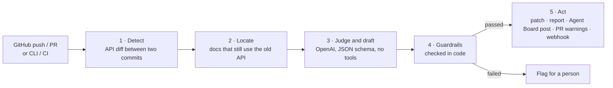
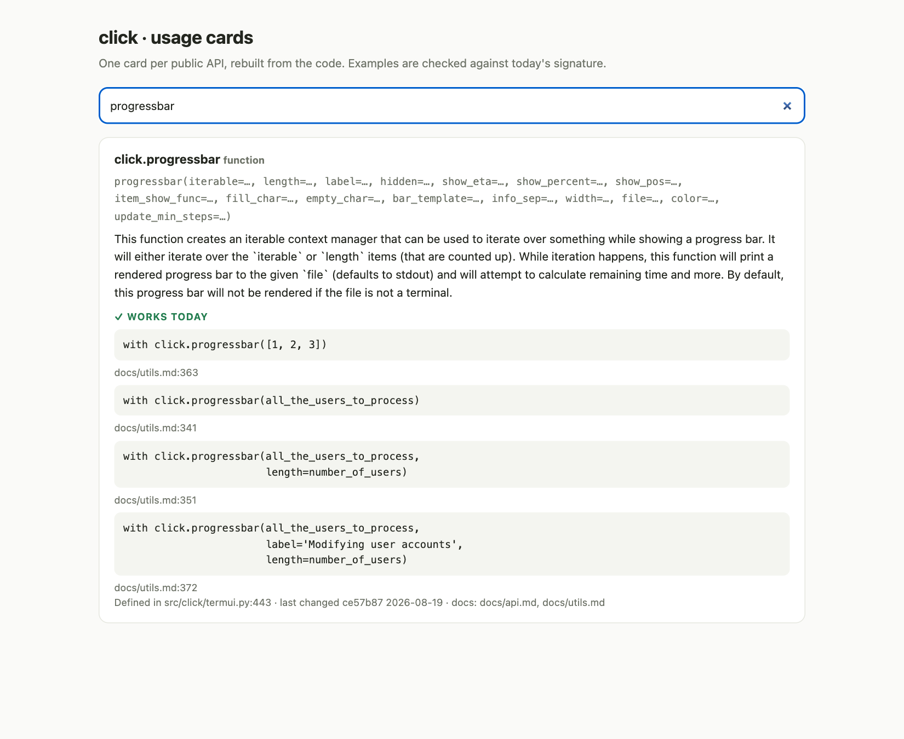

# DocDrift: docs that keep up with the code

### **Problem**: [2.12 GitHub Documentation](https://github.com/ain-problem-set/problem-2-12-github-documentation)

### **Code**: [src/docdrift/](../src/docdrift/) · runs with `python3 src/docdrift <command>` · reports to [Agent Board](design.md)

---

### The problem

Code changes every week. The docs change when someone remembers. A function is renamed, a parameter is removed, a class is deprecated, and the page that teaches it still shows the old way. The reader copies the example and it fails.

I wanted two things: catch those pages when the code changes, and serve docs that cannot fall behind, because they are rebuilt from the code.

---

### The workflow

| Step | Who does it | Action or reasoning |
|---|---|---|
| 1. Detect | Code reads the public Python API at both commits with `ast` (never imports it) | Action |
| 2. Locate | Code finds every doc line that uses the old name or parameter in code: code blocks, inline code, API directives | Action |
| 3. Judge and draft | OpenAI (the same `OPENAI_API_KEY` Agent Board uses) with **no tools** and a strict JSON schema for the answer: is this place really outdated, and what is the smallest correct rewrite? `claude -p` with `CLAUDE_KEY` works the same way. Without a key, offline rules do this step | Reasoning |
| 4. Guardrails | Code checks the draft before anything is written | Action |
| 5. Act | A `git apply` patch, a report for people, JSON for systems, a post on the Agent Board feed as the agent **Docs Drift**, warnings on the pull request, a signed webhook | Action |

The split is on purpose. Detection is cheap and finds every candidate. The model only judges the few candidates, so a run on click costs six model calls. The model never touches the repository: it returns text, and code decides whether that text is safe.

---

### What it found on a real project

The example is **pallets/click**, a widely used Python CLI library. From release 8.1.8 to click's main branch (commit `2247b35`, 4 Oct 2026), DocDrift finds 67 API changes and 6 places in the docs that still present the old API as current. One example: `docs/api.md` still documents `BaseCommand`, `MultiCommand` and `OptionParser` as normal classes. All three have been deprecated since 8.2.0, and click's own warning says "Use 'Command' instead". The page has stayed that way for over a year of releases.

---

### How I measured it

I didn't hand-label anything. The click maintainers already did: their later doc edits are the labels. For each pair of releases, I run detection on the docs as they were at the older release, then check which of those lines the maintainers edited before the newer release.

| Releases | API changes | Lines maintainers edited | Flagged before they edited | Recall | Precision (lower bound) |
|---|---|---|---|---|---|
| 7.1.2 → 8.0.0 | 9 | 0 | 0 | – | – |
| 8.0.4 → 8.1.0 | 4 | 1 | 1 | 1.0 | 1.0 |
| 8.1.8 → 8.2.0 | 55 | 18 | 18 | 1.0 | 0.86 |
| **All** | | **19** | **19** | **1.0** | **0.86** |

- **Precision is a lower bound.** A flag the maintainers did not edit is either a false alarm or a page they missed, like the `api.md` lines above.
- **Guardrails:** of 26 fixed test edits, all 26 unsafe ones were blocked.
- **Cost:** detection takes about 1.5 s per release pair and makes no model calls. With a key, there is one model call per flagged place, at most 25 per run, and a $0.50 cap per run for OpenAI. If OpenAI rejects the key, the run switches to the offline rules after one call.
- **Honest caveat:** I improved the detection rules while looking at these three pairs. On six other click release pairs there were no false alarms, but also almost no API changes, so they cannot measure recall. A second project would be the next test.

---

### Guardrails

A proposed edit is written only if every check passes. Otherwise the place is flagged for a person.

- It touches only the flagged doc section, and changes at most 12 lines.
- It deletes no more than half of the section.
- It adds no links and nothing that looks like a credential.
- It calls only names that exist in the new code (no invented API).
- It brings in no API name the project did not name as the replacement: only a rename's target, or the "Use 'X' instead" from the deprecation warning.
- It never edits an API-reference entry such as `autoclass`: dropping or annotating one is a person's decision.
- It keeps code fences intact, and Python examples still parse.
- The outdated reference is really gone afterwards.

**What the first live run taught me.** The first time I ran OpenAI on click, the model judged all six places correctly, but proposed five wrong fixes, and my guardrails at the time let them through:
- it replaced `get_text_stream` with `make_input_stream`, a different function;
- it rewrote the `BaseCommand` and `MultiCommand` entries so that `Command` was documented twice.

Every name it used existed in click, so the safety checks passed. I added the last two rules above. Now all six places go to a person with a clear reason, and nothing wrong is written. The model's judgement is useful; its rewrites need limits that code enforces.

Doc text is sent to the model between markers, as data, with the instruction not to follow it. The model has no tools, so injected text cannot run anything. If the model fails or returns bad JSON, the place is flagged, never silently passed.

---

### Docs served differently

`cards` builds one **usage card** per public API, from the code at that commit:
- the real signature today;
- examples taken from the project's own docs and tests, each checked against that signature (**works today**);
- examples the docs still show that no longer work;
- where the API is defined, and when that code last changed.

`ask "show a progress bar"` finds the right card without reading any page. Because cards are rebuilt from the code, they cannot drift. On click: 58 cards and 153 verified examples.

---

### Hooks and deployment

- **Agent Board:** `check --post-to-board http://127.0.0.1:8087` registers DocDrift as the agent **Docs Drift** and posts each result to the board's feed, so documentation problems sit next to the other agents' work. `run.yaml` does this.
- **CLI and CI:** `check --github-annotations` shows each outdated place as a warning on the pull request. `--fail-on-outdated` can block a merge. A ready workflow file is in `deploy/docdrift-github-action.yml`.
- **Webhook service:** `serve` accepts GitHub `push` and `pull_request` webhooks, verified with the `X-Hub-Signature-256` HMAC. It runs the check and POSTs the result to `DOCDRIFT_NOTIFY_URL` (Slack, Teams, a ticket system), signed the same way. It also serves the cards over HTTP. A Dockerfile is in `deploy/docdrift.Dockerfile`.
- **JSON everywhere:** `report.json` and `cards.json` let any other system consume the results.

---

### Current status and future work

Built and tested: detection, the OpenAI, `claude -p` and rules reasoners, guardrails, the patch, reports, the Agent Board post, cards, `ask`, the webhook service, and 17 offline tests. The model paths are tested against a fake OpenAI server and a fake `claude` CLI. One live OpenAI run on click: 6 calls, $0.005, 12 s. All six verdicts were correct, and all six fixes were rightly blocked.

Next steps:
- Measure the live verdicts on more releases and projects.
- Open the patch as a pull request.
- Support languages beyond Python (tree-sitter).
- Catch behaviour changes that keep the same signature.
- Smarter `ask` ranking with embeddings.
