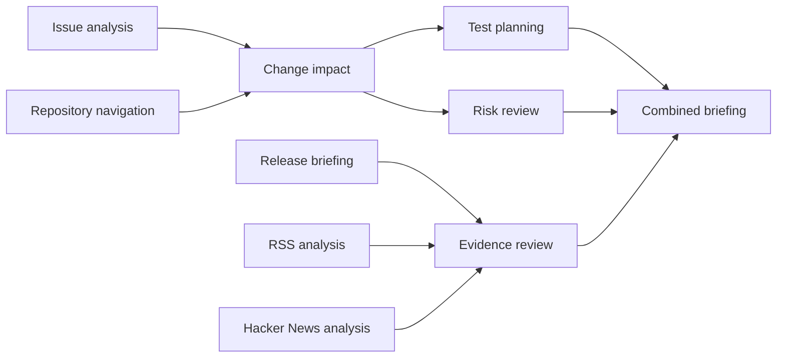

# Skills, agents and workflows: how to use them

A **skill** says how to do a kind of work. An **agent** is a named teammate that follows one skill. A **workflow** connects agents so each result feeds the next. None of them is written in code.

## Skills

Ten reusable skills ship in `src/main/resources/workflows/skills.json`: issue analysis, repository navigation, change impact, regression test planning, risk review, release briefing, RSS analysis, Hacker News analysis, evidence review and a combined briefing. Each has instructions, the read-only tools it may use, and an output contract.

To add one: **Agents → Create skill**, or add an entry to `skills.json`. To change one, **Edit skill**; runs already started keep their copy.

## Agents

**Create agent** asks, in order: which reusable skill (a dropdown of all of them, with a preview), what the agent is for, a name, which OpenAI model, and where its input comes from (every connector the board has, listed by the server). You can also write a YAML file; see [design.md](design.md#3-the-data-model-everything-that-varies-is-data).

## Workflows

1. **Workflows → Build with this agent** (or **Add an agent** on an open workflow).
2. Press **Connect** on a card and choose the agent that should receive its result. Choose it again to disconnect. A loop is refused. An agent with several inputs waits for all of them.
3. The workflow saves itself.
4. **Run workflow.** The dialog asks only for the sources the chosen tools need (repository, issue, branch or commit, feed address, number of stories). Nothing is pre-filled.
5. Follow the cards; open **Evidence** on a card for findings, citations, tool calls, responses and cost.

## The ten-agent example

```sh
bash ./scripts/start-local.sh --demo
```

loads ten agents (one per skill) and the workflow **Ten-agent engineering briefing**:



Open it under **Workflows**, press **Run workflow**, enter a public repository, an issue number, a branch and a feed address, and start it. Running needs `OPENAI_API_KEY`; building and connecting do not.
