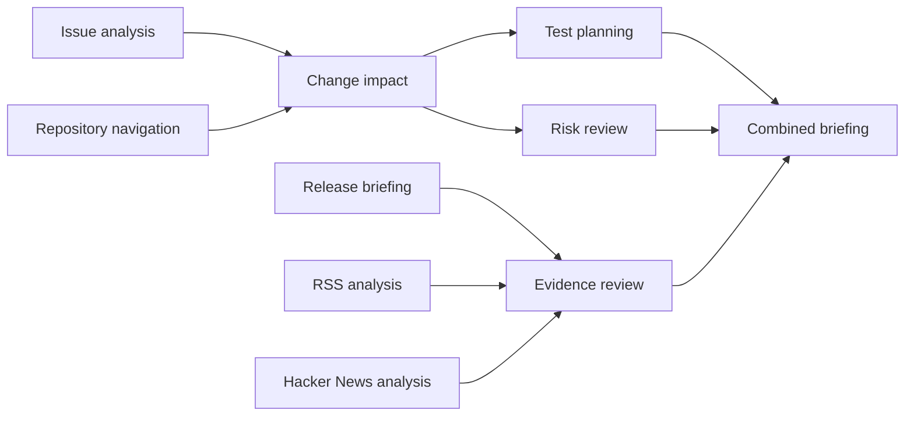

# Skills, agents and workflows: how to use them

A **skill** says how to do a kind of work. An **agent** is a named teammate that follows one skill. A **workflow** connects agents so each result feeds the next. None of them is written in code.

## Skills

Ten reusable skills ship in `src/main/resources/workflows/skills.json`: issue analysis, repository navigation, change impact, regression test planning, risk review, release briefing, RSS analysis, Hacker News analysis, evidence review and a combined briefing. Each has required instructions and selected MCP connector tools. Describe the action, target repository or URL, branch/ref when relevant, and what to return. A reusable skill can say to get these details from the workflow request and ask a specific question when they are missing. Connect a server under **Connectors**, then edit a skill to choose that server’s tools. Built-in read tools are unavailable. Skills with no tools use supplied workflow context and upstream results.

To add one: **Agents → Create skill**, or add an entry to `skills.json`. To change one, **Edit skill**; runs already started keep their copy.

## Agents

**Create agent** asks, in order: which reusable skill (a dropdown of all of them, with a preview), what the agent is for, a name, and which OpenAI model. Workflow context and upstream results are supplied automatically; source access comes from the MCP tools selected on the reusable skill. You can also write a YAML file; see [design.md](design.md#3-the-data-model-everything-that-varies-is-data).

## Workflows

1. **Workflows → Build with this agent** (or **Add an agent** on an open workflow).
2. Press **Connect** on a card and choose the agent that should receive its result. Choose it again to disconnect. A loop is refused. An agent with several inputs waits for all of them.
3. The workflow saves itself.
4. **Run workflow.** Describe the actual task, such as an issue URL, repository and revision, in the workflow request. Agents use the MCP tools on their skills to retrieve information. A bare “start” gives a tool-free root agent nothing to analyze.
5. Follow the cards; open **Evidence** on a card for findings, citations, tool calls, responses and cost.

## The ten-agent example

```sh
bash ./scripts/start-local.sh --demo
```

loads ten agents (one per skill) and the workflow **Ten-agent engineering briefing**:



This optional example supplies a layout. Configure source skills with your connected MCP tools before running it. Include a public repository, issue URL, revision and feed address in the workflow request. Running needs `OPENAI_API_KEY`; building and connecting do not.

A briefing agent should receive results from collectors/reviewers. For a simple chain, connect **collector → evidence reviewer → briefing**. Card position does not define execution order: the connections do. If information is missing, an honest model response with no findings and explicit uncertainties is shown as **Needs information**. No workflow is automatically retried.

## Example instructions

For a fixed task: “Read the latest commit on main in OWNER/REPO. Return its SHA, author, date and message. Do not modify the repository.” Replace OWNER/REPO with your own repository.

For reuse: “Use the repository and branch supplied in the workflow request. Retrieve the latest commit and summarize its SHA, author, date and message. If either target is missing, ask for it before making a tool call.”

Choose the matching tools on the skill, then give the actual repository and branch in the run request. Instructions are required; the dashboard manages its report format internally.
