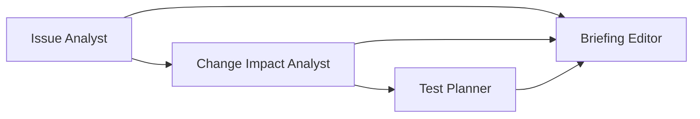

# Create your own agents from reusable skills

The board installs ten reusable skills. It creates no agents or teams automatically. Open **Agents** to inspect/edit a skill, then choose **Create agent with this skill**. Supply your own agent name and purpose. Creation saves configuration; a model runs only when you explicitly start work.

## Skills

| Reusable skill | Suggested agent name | Permitted tools |
|---|---|---|
| Issue analysis | Issue Analyst | Read the selected issue |
| Repository navigation | Repository Navigator | Read issue; list files; read pinned source ranges |
| Change impact analysis | Change Impact Analyst | Read issue, list files, inspect source |
| Regression test planning | Test Planner | Upstream evidence |
| Compatibility and risk review | Risk Reviewer | Upstream evidence |
| Repository release briefing | Release Reporter | Read recent releases |
| RSS analysis | RSS Scout | Read configured feed |
| Hacker News analysis | Hacker News Scout | Read top stories |
| Evidence review | Evidence Reviewer | Upstream evidence |
| Combined briefing | Briefing Editor | Upstream evidence |

Choose **Skill tools & upstream** as the input when using these tool-enabled skills. The tool configuration belongs to the reusable skill; run parameters choose the repository/issue/news sources. The separate RSS/Hacker News input choices can supply observations to your own custom model skills.

Each skill records instructions, permitted read tools and an output contract. Edit instructions to change behavior; custom instructions are sent to OpenAI. Already-started executions keep their pinned instructions. Every tool in the permitted set must be used successfully before a tool-enabled skill completes. A skill using only upstream evidence should have no tools selected.

## First workflow: GitHub impact report

Create four agents from Issue analysis, Change impact analysis, Regression test planning and Combined briefing. In **Workflows → Blank workflow**, add them and connect:

Click **Run workflow**. The initial public example is `psf/requests`, issue `7634`, commit `611c6162cbc4ac2020a2f91c7cfa4f3abf9bbb60`. You can change these inputs; branch names resolve to a recorded commit. Leave extra source text empty for this workflow. The report describes proposed changes and likely affected files; it neither edits the repository nor executes its tests.

Inspect **Evidence** on an agent for the detailed findings, validated source citations, uncertainty, model response IDs, tokens and read-tool trace. Click a source link to view the pinned lines. Click a connection below the canvas to see the producer's result, the receiver's input and dependency waiting.

## Second workflow: news digest

Create agents from RSS analysis, Hacker News analysis and Combined briefing. Connect both source agents to the briefing agent; do not connect the source agents to each other. Their work can overlap, subject to worker/model concurrency limits. The editor waits for both successful outputs.

Default sources: `https://github.blog/changelog/feed/`, seven days; top three Hacker News stories. Public RSS/HN need no account. A feed may legitimately have no recent dated items; the model must report that limitation.

## Optional ten-agent engineering briefing

Create the remaining agents from Repository navigation, Compatibility and risk review, Repository release briefing and Evidence review. Reuse your existing six agents, then connect this graph:

- Issue Analyst, Repository Navigator, Release Reporter, RSS Scout and Hacker News Scout start independently.
- Issue Analyst + Repository Navigator → Change Impact Analyst.
- Change Impact Analyst → Test Planner and Risk Reviewer.
- All eight preceding agents → Evidence Reviewer.
- Evidence Reviewer → Briefing Editor.

There are exactly ten agents in this graph. Each name, purpose, skill and connection is editable data. Keep repository evidence distinct from broader news context in the final brief.

## Model usage and failures

Every new agent reasoning result comes from OpenAI. The default configured model is shown before execution. Missing credentials, unavailable models, invalid output, source errors and budget exhaustion fail visibly; there is no local substitute. Independent branches can complete while a failed dependency blocks receivers.

Each agent has at most four model requests and twelve read-tool calls. Model context is bounded to 48,000 characters including instructions and tool/output schemas. Joins with more than three predecessors use explicit excerpts: each summary, up to four findings and two uncertainty items per predecessor. The evidence panel shows the actual model input and omissions; full producer reports remain stored. Source reads are excerpts; omissions are recorded. A final file citation must reference retrieved evidence and an inspected source range. URL-only citations are rendered without file line coordinates; any coordinate normalization is marked in the recorded citation. A valid citation does not itself prove the model's interpretation is correct; review hypotheses and proposed changes.

The persistent usage ledger limits estimated reservations and attempts. Starting a run is the explicit action authorizing requests against the configured allowance. Historical non-model runs retain their original provenance.
