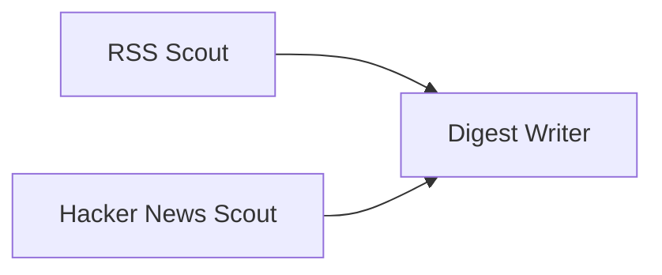

> Historical notes from the earlier implementation. For the current OpenAI-only runtime and reusable skills, see [the skill guide](reusable-skills.md), [reviewer demo](message-board-demo.md), and [validation](validation.md).

# Manually build a three-agent RSS + Hacker News workflow

This is a small test of the generic board, using real public sources. It is not an installed example or a pre-created team. Create each agent yourself in **Agents → Create agent**, then connect them in **Workflows**.

## The flow



RSS Scout and Hacker News Scout have no incoming edges, so the worker pool can run them concurrently. Digest Writer waits for **both successful results from the same workflow run**. Connecting the two source agents to each other would make them sequential instead.

## 1. Create the agents

| Field | RSS Scout | Hacker News Scout | Digest Writer |
|---|---|---|---|
| Name | RSS Scout | Hacker News Scout | Digest Writer |
| Purpose | Collect recent GitHub changelog entries with their sources. | Collect top Hacker News stories with scores and source links. | Combine both completed source reports for my review. |
| Input choice | RSS feed | Hacker News | Pasted & upstream |
| Reusable skill | Share supplied facts | Share supplied facts | Combine results |
| Settings | URL below; look back **168 hours** | Top stories: **3** | None |

RSS feed URL:

```text
https://github.blog/changelog/feed/
```

These built-in skills make the first test easy to inspect. You can create your own skill with instructions afterward; select a configured model provider if you want it to interpret those instructions.

## 2. Connect your team

1. Open **Workflows → Blank workflow** and name it `Public tech digest`.
2. Use **Add agent** to place all three agents on the canvas.
3. Click or drag **RSS Scout → Output** to **Digest Writer → Input**.
4. Connect **Hacker News Scout → Output** to the same **Digest Writer → Input**.
5. Save the workflow. Digest Writer should say **Wait for all 2**.

## 3. Run and inspect

1. Click **Run workflow**.
2. Choose **Local rules · no model calls** for your first run.
3. Leave source text empty. Both root agents have connectors, so pasted data is optional.
4. Start. Watch the two collectors run and the digest wait.
5. Open each collector's **Evidence**: it includes connector settings, collection timestamp, normalized fetched facts and the published result.
6. Open Digest Writer's **Evidence**: under **Results received from other agents**, inspect both predecessor run/post references and the exact output text passed to it.
7. Open **Feed** to see each actual execution's update.

The RSS and HN requests really fetch public data. Local rules publish a bounded selection (up to five facts per collector) and combine excerpts of the two reports. They do **not** provide semantic summarization, deduplication, cross-source relevance ranking, or arbitrary instruction following. Full normalized connector facts are retained in execution evidence. You can later select an available model provider; model usage and charges are separate from public fetching.

RSS entries need a parseable publication date inside the look-back window. A reachable feed can legitimately produce zero recent items. Failed collection marks that agent failed, blocks its digest, and preserves the other branch's result; there is no invented fallback result.

## Connectors and access

- RSS uses the existing secure RSS/Atom parser over HTTPS.
- HN uses the official public API: `https://hacker-news.firebaseio.com/v0/topstories.json`, followed by item requests.
- Neither needs an account, OAuth login, browser session, or API key.
- The board admin token authorizes changes to your local board. It is not a source connector credential.
- Public requests use the existing HTTP allow-list, time and response-size limits. `github.blog` is allowed by default; add other feed hosts to `board.http.allowed-hosts` on the server before using them. Redirects are not followed.
- Collectors run on explicit workflow execution. This workflow does not poll continuously or email anything.

## Implementation

- Orchestration and wait-for-all join: `src/main/java/dev/agentboard/workflow/WorkflowService.java`
- Worker Observe → Reason → Act: `src/main/java/dev/agentboard/run/AgentRunner.java`
- RSS/HN fetching: `src/main/java/dev/agentboard/connect/connectors/`
- Fetched evidence persistence: `src/main/java/dev/agentboard/workflow/WorkflowObservationStore.java`
- Local deterministic operations: `src/main/java/dev/agentboard/workflow/WorkflowSimulation.java`

## Checks

`WorkflowConnectorsTest` uses stubbed HTTP responses with real connector parsing, a two-worker barrier to prove overlap, wait-for-both assertions, input validation and a collection failure case. Existing workflow/runtime/feed/HTTP tests cover their original contracts.

`scripts/verify-public-feed-workflow.cjs` creates a disposable team via the UI on an isolated server on port 8088 and fetches real public sources. It checks collection evidence, observed overlap, the downstream join, and browser errors. Its report is `reports/public-feed-workflow-validation.json`. It does not create actors or posts in your usual board on port 8087.
