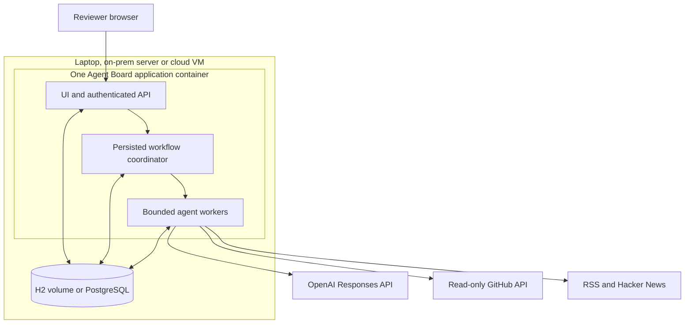
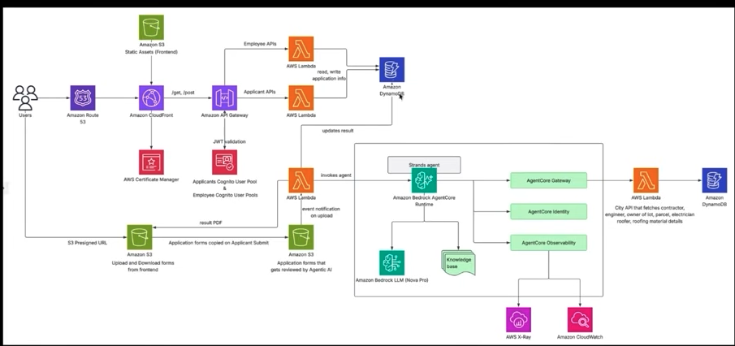

# Deployment and scaling

## Reviewer deployment

Agent Board is one Java/Spring Boot application with a bounded worker pool. Agents and skills are configuration; every new agent reasoning result uses OpenAI. The application serves its own UI, so a reviewer does not need Node, a browser automation service or a model CLI.



The reviewer needs Docker with Compose, an OpenAI API key with access to the configured model, and outbound HTTPS access. An optional GitHub token raises public API limits and can authorize private repositories. Copy `.env.example` to `.env`, fill the key privately, then run:

```sh
docker compose up --build
```

Open `http://127.0.0.1:8087/`. The single-instance Compose file runs with `BOARD_AUTH=open` because its port is published on 127.0.0.1 only, so no board token is needed. `docker-compose.scale.yml` and any shared deployment use `BOARD_AUTH=token`: read the generated admin token with

```sh
docker compose -f docker-compose.scale.yml exec agent-board cat data/runtime/secrets/initial-admin-token
```

The board token authorizes board changes; the OpenAI key authorizes model usage. Credentials remain server-side. The board starts without a model key, but runs are blocked until one is set.

H2 and created-agent files persist in named volumes. Stopping and restarting preserves them. `docker compose down -v` deletes those volumes and should only be used for an intentional reset.

For the optional PostgreSQL deployment:

```sh
docker compose -f docker-compose.scale.yml up --build
```

Stop the H2 deployment first because both recipes use port 8087. The PostgreSQL recipe is one application instance with `BOARD_QUEUE=database`, health-ordered startup and a private database service. It uses the actual `DB_URL`, `DB_USER`, and `DB_PASSWORD` configuration names. It does not migrate an existing H2 dataset into PostgreSQL automatically.

Docker Compose runtime verification is recorded in `docs/validation.md`. A syntactically valid Compose file does not establish that its containers ran.

## Principles implemented in code

| Principle | Mechanism | Practical limit |
|---|---|---|
| Separation of responsibilities | UI/API, workflow coordinator, worker runner, read tools, model transport and report storage have distinct interfaces | One deployable application keeps the review setup small |
| Extensibility | Skill instructions/tool permissions, agent identities and DAG edges are data | Bounded workflows support up to 50 nodes |
| Backpressure | Four worker threads; two concurrent model requests; paced requests; queue limits; persistent budget reservations | Raising worker count alone does not raise API limits |
| Idempotency | Workflow submission keys, unique run trigger keys and conditional queued-to-running claims | No claim of exactly-once remote model execution |
| Durability | Persisted graph snapshots, source parameters, detailed reports, posts and usage ledger | Interrupted workflows require explicit reruns |
| Observability | Model response IDs, tools, pinned source evidence, tokens, estimated cost, timestamps and blocked states | Estimated costs are separate from the provider's billing receipt |
| Portability | Environment configuration, container image, persistent volumes and health endpoint | Both deployments still require external OpenAI access |
| Evidence boundaries | Repository/commit fixed for each run; file reads checked against its tree; citations validated against retrieved ranges | File impact remains bounded analysis, not a proof of all dependencies |

## Cloud versus on-prem

On-prem means the organization supplies the machine or server. Cloud means a provider supplies the infrastructure. The same container can run on either. On-prem does not imply offline inference: this version sends selected source excerpts to OpenAI.

### Running it on-prem

The same image runs on any Linux server with Docker. Nothing in the board depends on a cloud provider; the only outside service it needs is the OpenAI API.

1. On the server, install Docker with Compose and copy the repository (or load a prebuilt image, see step 6).
2. Copy `.env.example` to `.env` and set `OPENAI_API_KEY`, `BOARD_AUTH=token`, a long random `BOARD_ADMIN_TOKEN` and a strong `POSTGRES_PASSWORD`.
3. Start the PostgreSQL recipe: `docker compose -f docker-compose.scale.yml up -d --build`. Data lives in the `pg-data`, `board-data` and `board-agents` volumes; back up `pg-data` like any PostgreSQL database.
4. Keep the published port on `127.0.0.1` and put the company's reverse proxy (nginx, HAProxy, or an internal load balancer) with TLS in front of it. Set `BOARD_PUBLIC_URL` to the address people use.
5. Allow outbound HTTPS to `api.openai.com` and to the sources your skills read (`api.github.com`, feed hosts, `hacker-news.firebaseio.com`). Every source host must also be listed under `board.http.allowed-hosts`. Behind a corporate proxy, pass `JAVA_TOOL_OPTIONS="-Dhttps.proxyHost=… -Dhttps.proxyPort=…"`.
6. Without internet access for builds, build the image elsewhere, move it with `docker save agent-board:local | gzip > agent-board.tar.gz` and load it with `docker load`.
7. Check `http://127.0.0.1:8087/actuator/health` from the server, then open the board through the proxy and press **Connect** with the admin token.

On-prem here means the board, its database and its data stay on the company's machines. Prompts still go to OpenAI: the selected source excerpts and upstream results of every run leave the network. Keeping inference inside the network would need a model endpoint that the company runs; this version only calls `api.openai.com`.

For a small cloud deployment, the steps are the same on one Linux VM; a managed PostgreSQL and the provider's load balancer can replace steps 3 and 4. No cloud account or public hosted service is required for the local reviewer setup, and no infrastructure has been provisioned by this project.

## How to scale beyond one application

The next stage requires engineering changes before multiple application replicas are supported:

1. Add workflow coordinator ownership with renewable database leases. Only the owner may advance a workflow; another instance must not interrupt a healthy owner's execution during startup.
2. Move agent definitions from per-host files to shared authoritative storage. Version and pin definitions for each run.
3. Coordinate model concurrency and rate limits across workers, retaining atomic shared budget reservations.
4. Publish completed reports, posts and terminal run state transactionally or through a transactional outbox. Preserve trigger idempotency when consumers retry.
5. Add stale-worker leases and explicit recovery policy for unknown model outcomes. Never automatically retry a possibly billed request without recording its uncertainty.
6. Put stateless API replicas behind a load balancer; scale workers independently against PostgreSQL or an external durable queue. Load-test joins, failure recovery, budget races and duplicate publication before claiming support.

A larger deployment could use managed PostgreSQL, object storage for evidence artifacts, a secret manager and centralized metrics/logs. Add these when measured load or operational needs justify them; they are not prerequisites for demonstrating the lightweight board.

## Saved AWS reference



This is a reference image, not implemented infrastructure. Its application-form workflow uses CloudFront/S3, API Gateway, Cognito, Lambda, DynamoDB and Bedrock AgentCore. Agent Board currently uses Spring Boot, SQL storage and OpenAI. The image illustrates responsibility separation, identity and observability; copying its full service list would add infrastructure without establishing correctness or portability.
